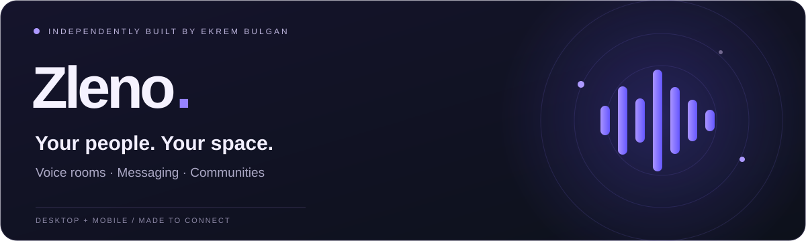
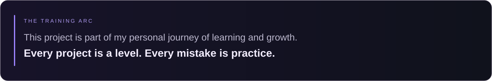

  

  
  &nbsp;
  

  <a href="README.md">Türkçe</a> &nbsp; / &nbsp;
  <a href="#try-it-on-your-phone">Try Android</a> &nbsp; / &nbsp;
  <a href="docs/LINUX.md#english">Linux guide</a> &nbsp; / &nbsp;
  <a href="https://github.com/idginity124/Zleno/issues/new/choose">Feedback</a> &nbsp; / &nbsp;
  <a href="https://www.ekrembulgan.com">ekrembulgan.com</a>

 

**Meet your friends in a room. Keep your community together.**

Zleno brings voice conversations, community channels, and direct messages into one independently developed app. Built by Ekrem Bulgan with personal resources.

> **Currently Turkish only.** An English interface is planned for an upcoming update. Feedback in either language is welcome.

 

## More ways to connect

**Meet in voice rooms.** Talk with friends and be part of the conversation.  
**Make space for your community.** Bring conversations together with servers and text channels.  
**Stay in touch.** Connect through direct messages, friends, and file sharing.  
**Make it yours.** Customize your profile and appearance.

  
   
  Desktop interface preview. Appearance and feature availability may vary by version.

  
  &nbsp;
  
   Theme editor on the left, workspace settings on the right. Click an image to enlarge.

## Take Zleno with you

| Platform | Status | Get started |
| :--- | :--- | :--- |
| **Windows** | Available on Microsoft Store · Free | [Get it on Microsoft Store ↗](https://apps.microsoft.com/detail/9NK6QQKSLSHD) |
| **Android** | Google Play testing | [Join in three steps ↓](#try-it-on-your-phone) |
| **Linux** | 0.1.9 packages built · Pre-release testing in progress | [Packages and installation guide →](docs/LINUX.md#english) |
| **macOS** | Planned | [Roadmap →](ROADMAP.md) |

### One step closer to Linux

**Arch / CachyOS, DEB and RPM packages have been built.** Installation, voice and desktop testing is next for the first Linux release. AppImage preparation continues; Linux downloads are not available yet.

[Explore the Linux guide →](docs/LINUX.md#english) &nbsp; · &nbsp; [Development notes →](CHANGELOG.md#english)

## Try it on your phone

Access the Android app through Google Play:

1. **Join the community** → [Zleno Google Group](https://groups.google.com/g/zleno)
2. **Accept the invitation** → [Google Play testing](https://play.google.com/apps/testing/com.zleno.app)
3. **Install the app** → [Zleno on Google Play](https://play.google.com/store/apps/details?id=com.zleno.app)

Use the **same Google account** throughout. If access is unavailable, check your group membership and testing opt-in, then try again later.

## One developer. A growing idea.

I am building Zleno with my own resources. A limited budget has kept me from growing the app and its server infrastructure as quickly as I would like. As resources allow, my aim is stronger infrastructure and a better experience.

**Trying the app, reporting an issue, or sharing it with a friend all help.** Financial support is optional; a direct support link will be added to the [support page](SUPPORT.md#english) when available.

[Ways to support →](SUPPORT.md#english) &nbsp; · &nbsp; [Share an idea →](https://github.com/idginity124/Zleno/issues/new/choose)

## What's next

**Android reliability** &nbsp; / &nbsp; **Linux release** &nbsp; / &nbsp; **macOS testing** &nbsp; / &nbsp; **English interface**

Server capacity improvements depend on available resources. These are goals without guaranteed delivery dates. [Explore the roadmap →](ROADMAP.md)

---

**Ekrem Bulgan** · Creator of Zleno  
[Website ↗](https://www.ekrembulgan.com) &nbsp; · &nbsp; [Feedback ↗](https://github.com/idginity124/Zleno/issues/new/choose) &nbsp; · &nbsp; [Tester community ↗](https://groups.google.com/g/zleno)

Enjoy Zleno? Leave a ⭐ to help others discover it.

© 2026 Ekrem Bulgan · Application source not included · [Usage terms](LICENSE) · [Security](SECURITY.md)
