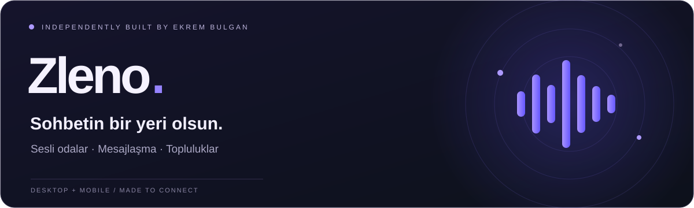
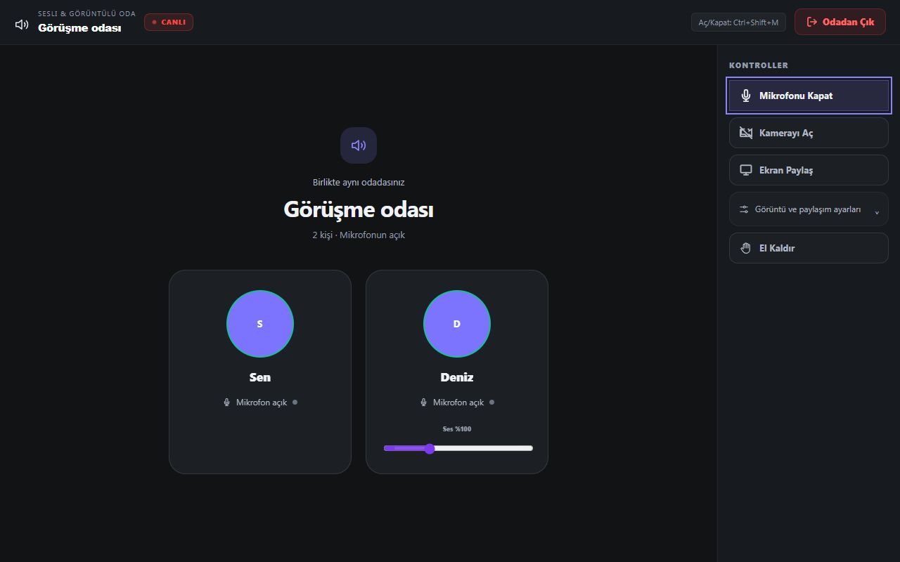
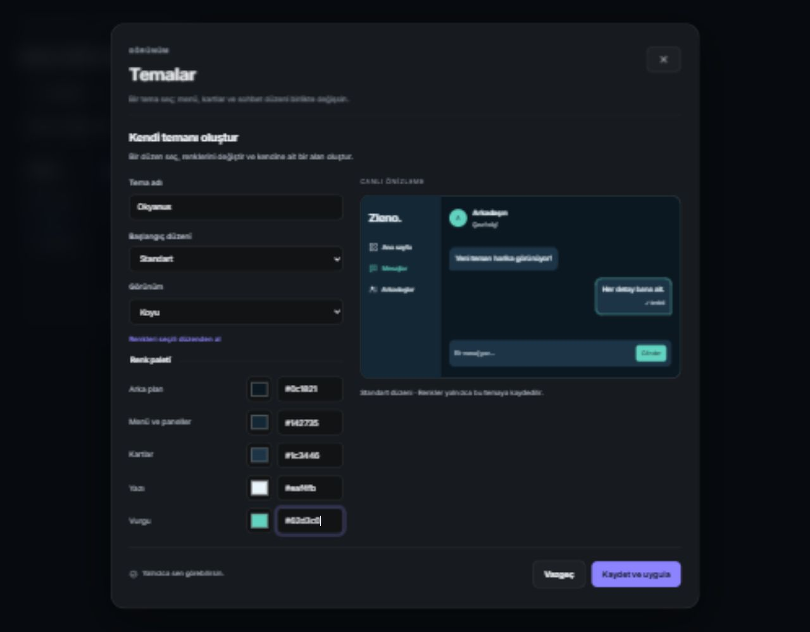
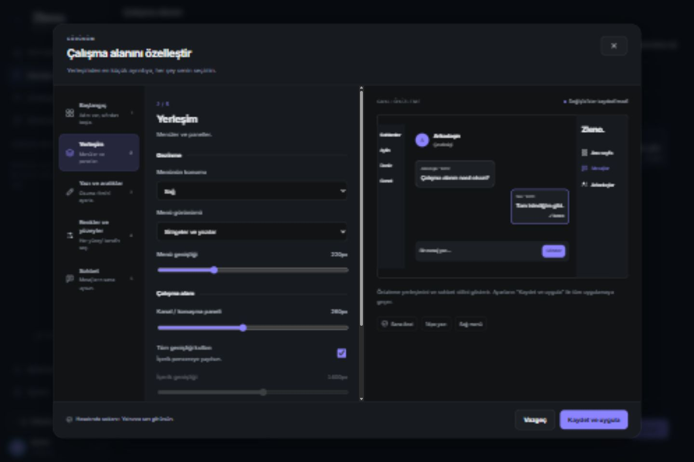
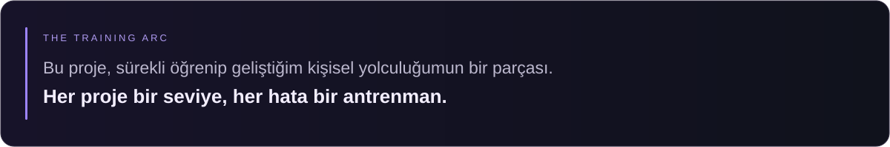

  

  
  &nbsp;
  
  &nbsp;
  

  <a href="README.en.md">English</a> &nbsp; / &nbsp;
  <a href="#uygulamadan-birkac-goruntu">Ekran görüntüleri</a> &nbsp; / &nbsp;
  <a href="#telefonda-dene">Android’e katıl</a> &nbsp; / &nbsp;
  <a href="docs/LINUX.md">Linux rehberi</a> &nbsp; / &nbsp;
  <a href="https://github.com/idginity124/Zleno/issues/new/choose">Geri bildirim</a> &nbsp; / &nbsp;
  <a href="https://www.ekrembulgan.com">ekrembulgan.com</a>

 

  Zleno’yu arkadaşlarla konuşmak, mesajlaşmak ve aynı yerde buluşmak için geliştiriyorum. Sesli odalar, sunucular ve özel mesajlar tek uygulamada. Ben Ekrem; projeyi tek başıma, kendi imkânlarımla sürdürüyorum.

<strong>Zleno tamamen ücretsiz.</strong> Arayüz şu an Türkçe; İngilizce desteği üzerinde de çalışmayı planlıyorum.

 

<h2 align="center">Uygulamadan birkaç görüntü</h2>

  Sesli odalarda konuşabilir, sunucu ve yazılı kanallar oluşturabilir, özel mesajlaşabilir ve dosya paylaşabilirsin. Tema ve çalışma alanı ayarlarıyla görünümü de kendine göre değiştirebilirsin.

  
   
  Masaüstü sesli oda önizlemesi. Görünüm ve özellikler sürüme göre değişebilir.

Tema ve görünüm ayarları

   
  
   Tema düzenleyicisi. Büyütmek için görsele tıkla.

  
   Çalışma alanı ayarları. Büyütmek için görsele tıkla.

<h2 align="center">İndir ve dene</h2>

<table align="center">
  <thead><tr>
    <th align="center">Platform</th>
    <th align="center">Durum</th>
    <th align="center">Başlangıç</th>
  </tr></thead>
  <tbody>
    <tr>
      <td align="center"><strong>Windows</strong></td>
      <td align="center">Microsoft Store’da yayında · Ücretsiz</td>
      <td align="center"><a href="https://apps.microsoft.com/detail/9NK6QQKSLSHD">Microsoft Store’dan indir ↗</a></td>
    </tr>
    <tr>
      <td align="center"><strong>Android</strong></td>
      <td align="center">Google Play test sürecinde</td>
      <td align="center"><a href="#telefonda-dene">Üç adımda teste katıl ↓</a></td>
    </tr>
    <tr>
      <td align="center"><strong>Linux</strong></td>
      <td align="center">0.1.9 test sürümü · x86_64</td>
      <td align="center"><a href="https://github.com/idginity124/Zleno/releases/tag/desktop-v0.1.9-linux-test">Linux sürümünü indir ↗</a></td>
    </tr>
    <tr>
      <td align="center"><strong>macOS</strong></td>
      <td align="center">Planlanıyor</td>
      <td align="center"><a href="ROADMAP.md">Yol haritası →</a></td>
    </tr>
  </tbody>
</table>

<h3 align="center">Linux test sürümü</h3>

  <strong>Linux 0.1.9 test sürümü indirmeye açık.</strong> Arch / CachyOS paketi ve deneysel DEB/RPM dosyaları mevcut. Bu ilk ön sürüm CachyOS x86_64 / glibc 2.44 üzerinde üretildi; diğer dağıtımlarda uyumluluk ve gerçek cihaz testleri henüz tamamlanmadı. AppImage hazırlığı sürüyor.

  <a href="https://github.com/idginity124/Zleno/releases/tag/desktop-v0.1.9-linux-test">Paketleri indir →</a> &nbsp; · &nbsp; <a href="docs/LINUX.md">Kurulum rehberi →</a> &nbsp; · &nbsp; <a href="CHANGELOG.md">Geliştirme notları →</a>

<h2 align="center">Telefonda dene</h2>

  Android sürümünü Google Play üzerinden denemek için:

  1. <strong>Topluluğa katıl</strong> → <a href="https://groups.google.com/g/zleno">Zleno Google Grubu</a> 
  2. <strong>Test davetini kabul et</strong> → <a href="https://play.google.com/apps/testing/com.zleno.app">Google Play test katılımı</a> 
  3. <strong>Uygulamayı indir</strong> → <a href="https://play.google.com/store/apps/details?id=com.zleno.app">Google Play’de Zleno</a>

  Üç adımda da <strong>aynı Google hesabını</strong> kullan. Erişim açılmazsa grup üyeliğini ve test katılımını kontrol edip daha sonra yeniden dene.

<h2 align="center">Sunucu masrafları ve destek</h2>

  Zleno’dan şu an gelir elde etmiyorum. Geliştirmeyi ve sunucu tarafını kendi bütçemle yürütüyorum; bu yüzden kapasiteyi istediğim kadar artıramıyorum. Kullanıcı sayısı arttıkça çıkacak sunucu masraflarını tek başıma karşılayamayabilirim.

  İmkânın varsa sunucu giderlerine destek olabilirsin. Desteğin, uygulamayı geliştirmeye devam etmeme ve sunucu kapasitesini artırmama yardımcı olur. Zleno’yu kullanmak için ödeme yapman gerekmiyor.

  

  Uygulamayı denemen, bir sorunu bildirmen veya bir arkadaşına önermen de çok işime yarar. Teşekkür ederim.

<h2 align="center">Sıradaki adımlar</h2>

  <strong>Android kararlılığı</strong> &nbsp; / &nbsp; <strong>Linux sürümü</strong> &nbsp; / &nbsp; <strong>macOS testleri</strong> &nbsp; / &nbsp; <strong>İngilizce arayüz</strong>

  Önce mevcut sürümleri daha kararlı hale getirmek, ardından platform ve dil desteğini genişletmek istiyorum. İlerlemeyi <a href="ROADMAP.md">yol haritasında</a> paylaşıyorum.

  <strong>Ekrem Bulgan</strong> · Zleno’nun geliştiricisi 
<a href="https://www.ekrembulgan.com">Web sitesi ↗</a> &nbsp; · &nbsp; <a href="https://github.com/idginity124/Zleno/issues/new/choose">Geri bildirim ↗</a> &nbsp; · &nbsp; <a href="https://groups.google.com/g/zleno">Test topluluğu ↗</a>

  Zleno’yu beğendiysen bir ⭐ bırakarak daha fazla kişiye ulaşmasına yardımcı olabilirsin.

© 2026 Ekrem Bulgan · Kaynak kodu içermez · <a href="LICENSE">Kullanım koşulları</a> · <a href="SECURITY.md">Güvenlik</a>

