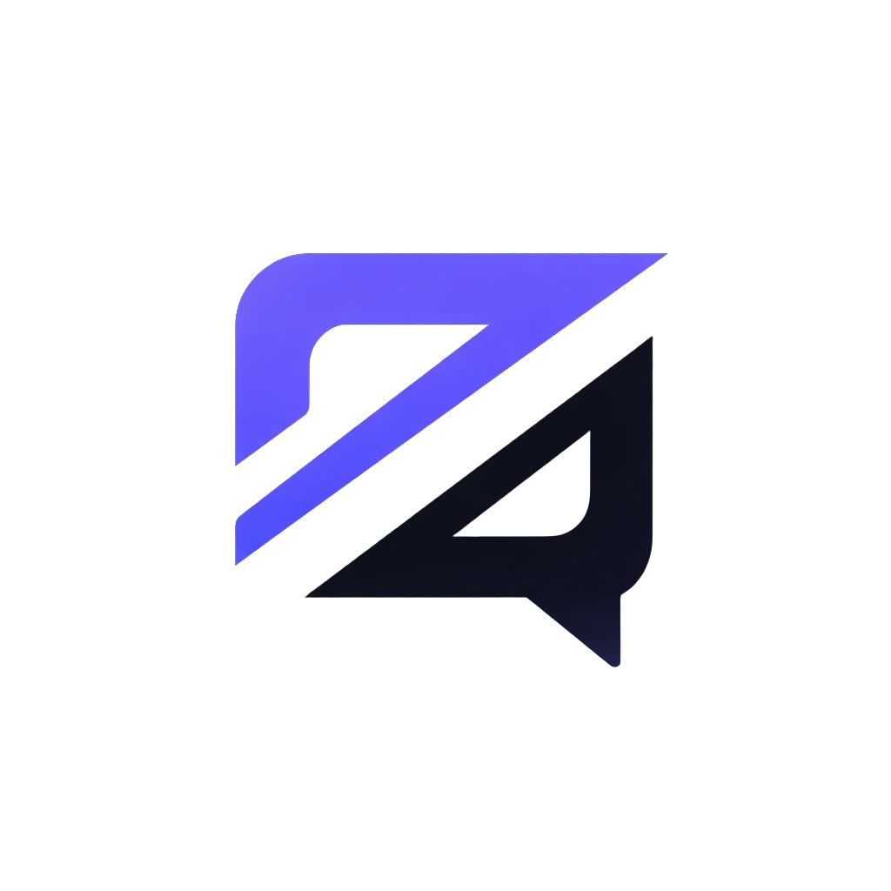

  
  <h1>Zleno</h1>
  
<strong>Aynı odada, aynı sohbette.</strong>

  
Sesli sohbet, mesajlaşma ve topluluklar için bağımsız bir uygulama.

  

    
    
  

  
<a href="README.en.md">English</a> · <a href="#platformlar-ve-indirme">İndir</a> · <a href="#android-testine-katıl">Teste katıl</a> · <a href="SUPPORT.md">Destek ol</a> · <a href="https://www.ekrembulgan.com">Geliştiricinin sitesi</a>

---

## Sohbetin bir yeri olsun

Zleno; arkadaşlarınla konuşabileceğin, topluluğun için kanallar oluşturabileceğin ve sesli odalarda bir araya gelebileceğin bir iletişim uygulaması. Ekrem Bulgan tarafından bağımsız olarak geliştiriliyor.

Bu depo, uygulamayı tanımak, mevcut sürümlere ulaşmak, gelişmeleri takip etmek ve geri bildirim paylaşmak için hazırlanmıştır. **Uygulamanın kaynak kodları bu depoda yayımlanmaz.**

> **Dil desteği:** Uygulama şu an Türkçe. İngilizce arayüz desteğinin yakında eklenmesi planlanıyor.

## Zleno ile neler yapabilirsin?

| | |
| --- | --- |
| **Birlikte konuş** | Sesli odalarda buluş, sohbetin içinde kal. |
| **Topluluğunu bir araya getir** | Sunucular ve yazılı kanallarla konuşmalarına alan aç. |
| **İletişimde kal** | Özel mesajlar, arkadaşlar ve dosya paylaşımıyla bağlantını sürdür. |
| **Kendi alanını oluştur** | Profilini ve görünümünü kişiselleştir. |

Özelliklerin kullanılabilirliği sürüme, platforma ve sunucu durumuna göre değişebilir.

<strong>Sesli oda arayüzüne göz at</strong>

*Masaüstü arayüzünden bir önizleme; yayımlanan sürümün görünümü farklı olabilir.*

## Platformlar ve indirme

| Platform | Durum | Nereden ulaşabilirim? |
| --- | --- | --- |
| **Windows** | Microsoft Store’da yayında | [Microsoft Store’dan aç](https://apps.microsoft.com/detail/9NK6QQKSLSHD) |
| **Android** | Google Play test sürecinde | [Test katılım adımları](#android-testine-katıl) |
| **Linux** | Sürüm hazırlığı sürüyor | Doğrulanmış paket hazır olduğunda duyurulacak. |
| **macOS** | Hedeflenen platform | Derleme ve cihaz testleri tamamlandıktan sonra değerlendirilecek. |

Linux ve macOS için henüz bu depoda indirilebilir paket yok. Hazır olmayan sürümler için indirme bağlantısı verilmez. Kesin yayın tarihi açıklanmamıştır.

## Android testine katıl

Zleno’yu telefonda denemek ve gelişimine katkıda bulunmak ister misin? **Mobil sürüme Google Play üzerinden katıl.**

| Adım | Bağlantı |
| --- | --- |
| **1 · Google Grubu’na katıl** | [Zleno test topluluğuna katıl](https://groups.google.com/g/zleno) |
| **2 · Test davetini kabul et** | [Google Play’de test kullanıcısı ol](https://play.google.com/apps/testing/com.zleno.app) |
| **3 · Uygulamayı indir** | [Zleno’yu Google Play’den aç](https://play.google.com/store/apps/details?id=com.zleno.app) |

Üç adımda da telefonunda Google Play için kullandığın **aynı Google hesabıyla** giriş yap. Erişim görünmüyorsa grup üyeliğini, test davetini ve seçili hesabı kontrol edip daha sonra yeniden dene.

Deneyimlerini, karşılaştığın sorunları ve önerilerini bu deponun **Issues** bölümünden paylaşabilirsin. Cihaz modelini, Android sürümünü ve uygulama sürümünü eklemen çok yardımcı olur.

## Küçük imkânlarla, adım adım

Zleno’yu kendi imkânlarımla geliştiriyorum. Bütçem sınırlı olduğu için projeyi ve sunucu altyapısını istediğim hızda büyütemedim. Mevcut sunucu kapasitesi de bu imkânlarla sınırlı; kullanıcı sayısı arttıkça kapasiteyi ve hizmetin sürekliliğini geliştirmeyi hedefliyorum.

Uygulamayı deneyerek, sorunları bildirerek ve çevrenle paylaşarak gelişimine katkıda bulunabilirsin. Maddi destek sağlamak istersen, [destek sayfasında](SUPPORT.md) güncel bilgileri bulabilirsin. Destek tamamen isteğe bağlıdır.

**Hedefim:** Daha sağlam bir altyapı, daha fazla platform ve birlikte şekillenen bir Zleno.

## Sırada neler var?

- [ ] Android test geri bildirimleriyle kararlılığı geliştirmek
- [ ] Linux sürümünü paketlemek ve gerçek cihazlarda doğrulamak
- [ ] macOS derleme ve test sürecini değerlendirmek
- [ ] İngilizce arayüz desteği eklemek
- [ ] Kaynaklar elverdikçe sunucu kapasitesini artırmak

Ayrıntılar: [Yol haritası](ROADMAP.md). Bunlar geliştirme hedefleridir; tarih veya tamamlanma garantisi değildir.

## Geri bildirim ve iletişim

Hata bildirmek veya özellik önermek için **Issues → New issue** yolunu kullan. Hesap bilgilerini, özel mesajları veya erişim anahtarlarını herkese açık bildirimlere ekleme. Güvenlik konuları için [SECURITY.md](SECURITY.md) dosyasına bak.

**Geliştirici:** [Ekrem Bulgan](https://www.ekrembulgan.com) · **Mobil test topluluğu:** [Google Groups](https://groups.google.com/g/zleno)

Zleno’yu faydalı buluyorsan bu depoya yıldız vererek daha fazla kişinin keşfetmesine yardımcı olabilirsin.

---

© 2026 Ekrem Bulgan. Bu depo bir tanıtım ve geri bildirim alanıdır; uygulama kaynak kodlarını veya açık kaynak lisansı sunmaz. İçerik ve görsel kullanım koşulları için [LICENSE](LICENSE) dosyasına bak.
